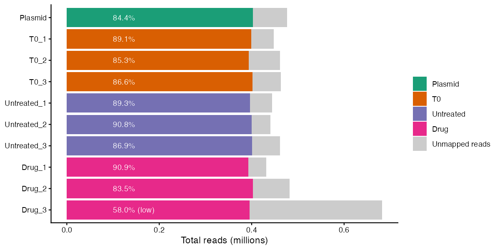
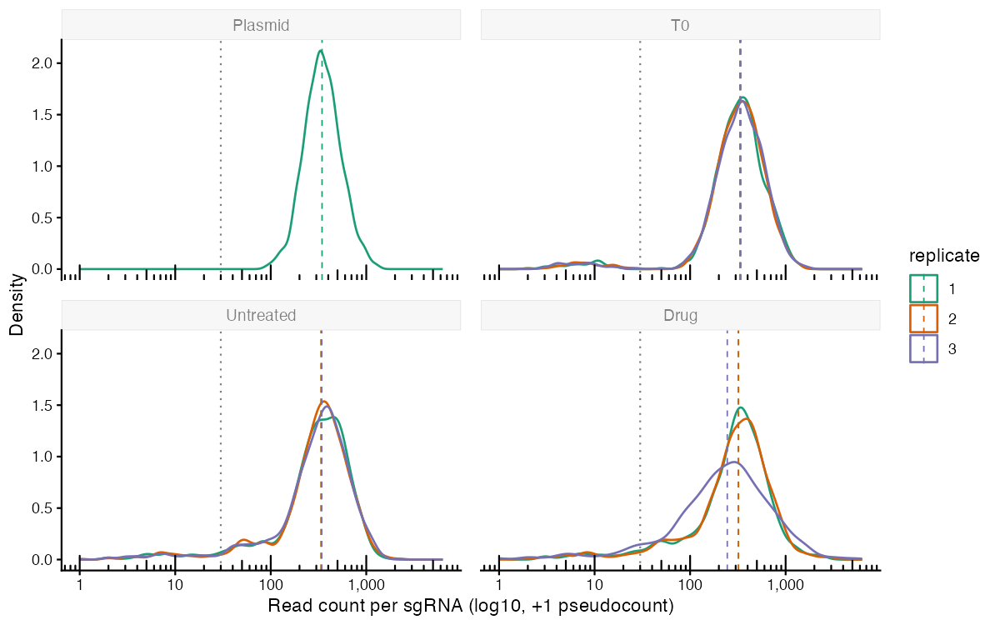
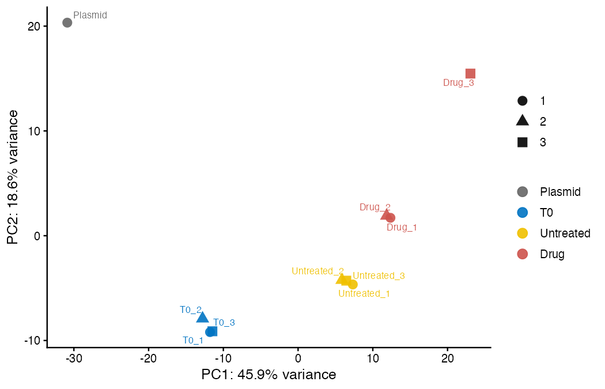
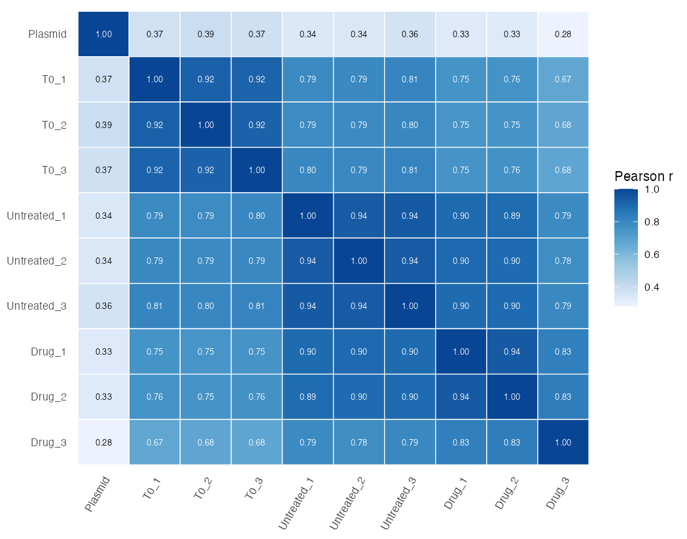

# crisprFlow 

<!-- badges: start -->
<!-- badges: end -->

The goal of crisprFlow is to provide wrappers and functions to facilitate the 
analysis of CRISPR-Cas9 screening data, from raw sequencing reads to biological 
insights. The package includes functions for quality control assessment, 
guide RNA counting, normalization, statistical analysis, and visualization 
of results. Importantly, the tool provides a reporting framework to ensure
reproducibility and transparency of the analysis workflow.

Currently, the package requires installation of external tools (non R-based) 
that are not automatically installed (*MAGeCK*, *guide-counter*). A containerized
version of the package is under development to ease the installation process.


## Installation

You can install the development version of crisprFlow like so:

``` r
remotes::install_github("sigven/crisprFlow")
```

## Output examples

<table>
<tr>
<td width="50%">

**Read mapping QC**<br>
Per-sample mapping rates with configurable minimum thresholds.



</td>
<td width="50%">

**Count distribution**<br>
Per-sample log-count distributions with low-count and median markers.



</td>
</tr>
<tr>
<td width="50%">

**Sample PCA**<br>
Principal component analysis of guide-level counts, coloured by group and shaped by replicate.



</td>
<td width="50%">

**Replicate correlation**<br>
Pairwise scatter plots across all replicates with Pearson *r* annotation.



</td>
</tr>
</table>

