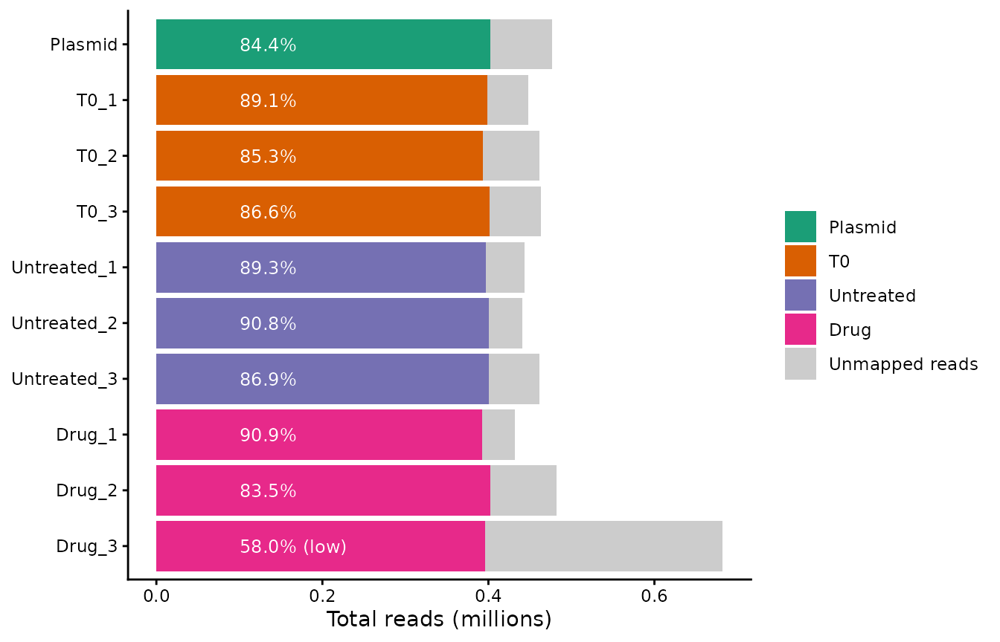
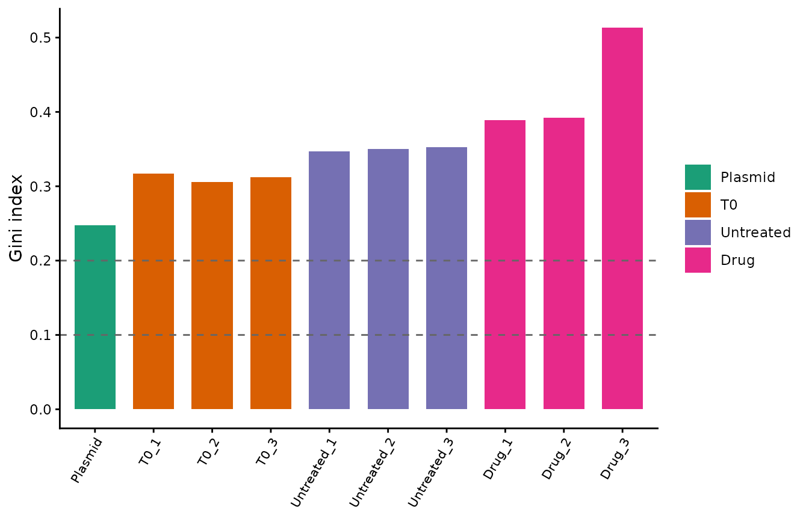
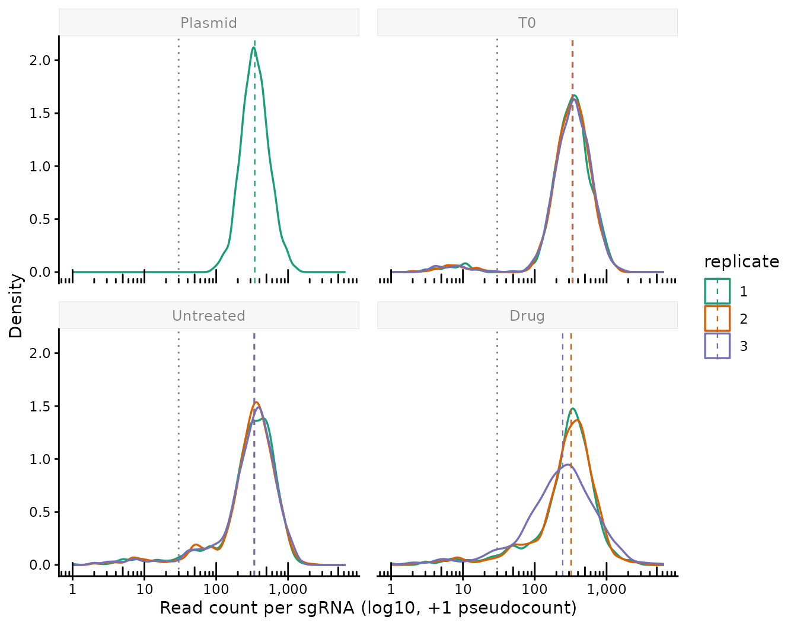
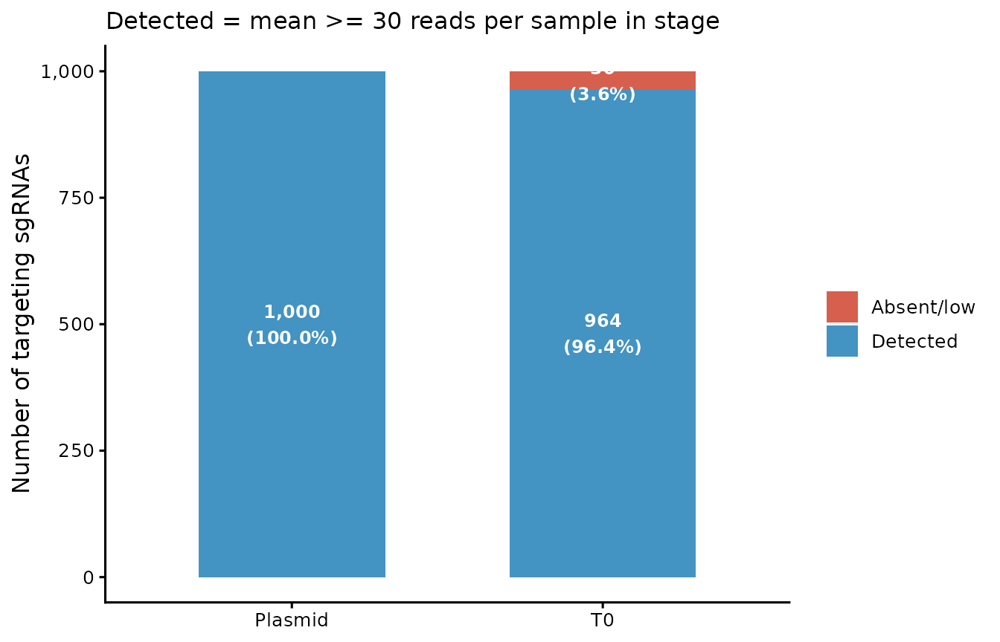
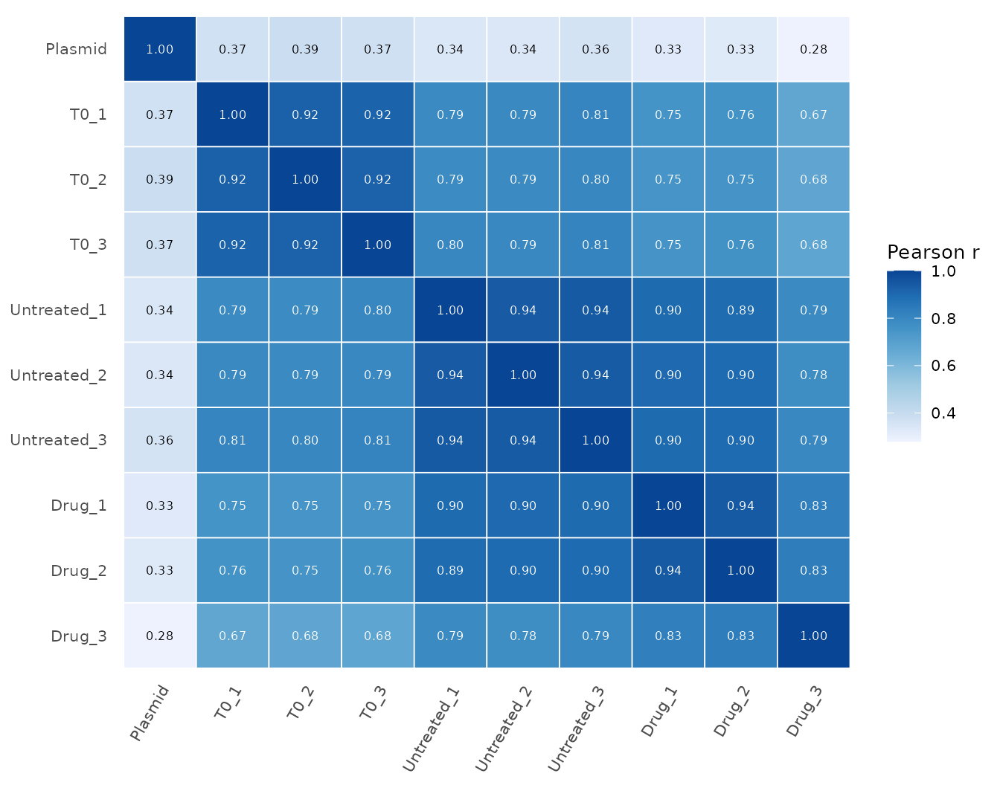
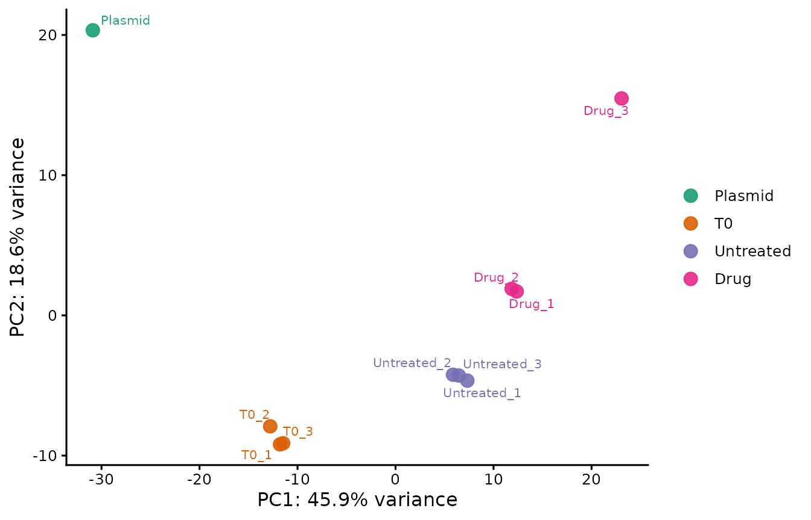
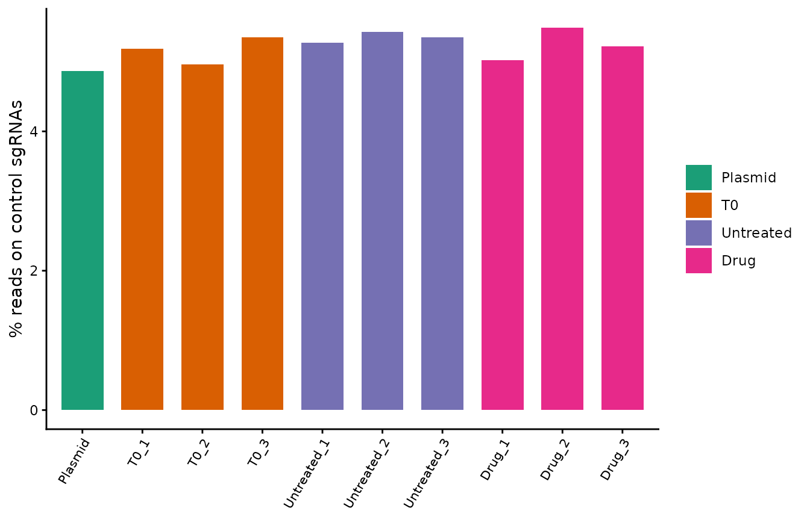
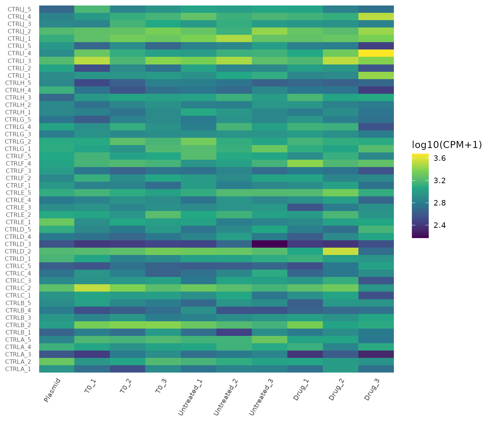
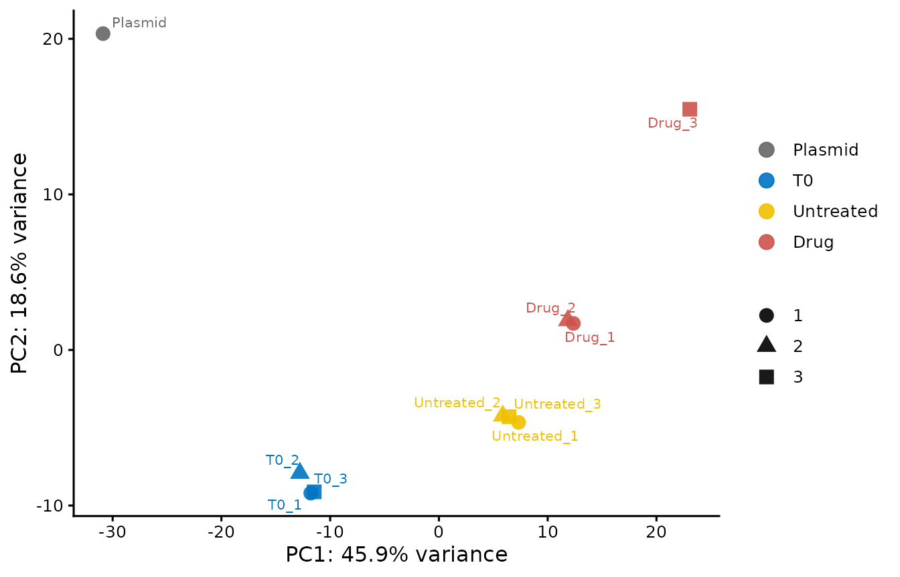

# Quality control of CRISPR screen counts

This vignette walks through quality control (QC) of a pooled CRISPR
screen with the `qc_*` functions in crisprFlow. It uses a small
simulated screen shipped with the package, but the same steps apply to
real count data.

``` r

library(crisprFlow)
```

## Inputs

The QC functions work from two tables, described in detail in
[`?qc_inputs`](../reference/qc_inputs.md).

**The count matrix** (`counts`) has one row per sgRNA, the columns
`sgRNA` and `Gene`, and one column of raw counts per sample. This is the
layout written by MAGeCK and guide-counter.

``` r

counts <- exampleCounts
head(counts)
#>    sgRNA Gene Plasmid T0_1 T0_2 T0_3 Untreated_1 Untreated_2 Untreated_3 Drug_1
#> 1 AAK1_1 AAK1     227  192  236  201         193         227         412    178
#> 2 AAK1_2 AAK1     299  251  261  336         220         353         270    241
#> 3 AAK1_3 AAK1     224  125  146  185         164         194         219    200
#> 4 AAK1_4 AAK1     548  479  430  703         557         544         376    350
#> 5 AAK1_5 AAK1     183  201  158  171         221         267         152    141
#> 6 ABL2_1 ABL2     658  434  481  551         786         724         773    518
#>   Drug_2 Drug_3
#> 1    193    287
#> 2    199     88
#> 3    220    103
#> 4    391    292
#> 5    171    103
#> 6    765    195
```

**The sample table** (`meta`) has one row per sample, and links each
count column (`sample_id`) to a display `label`, a biological `group`
and a `replicate`. The row order sets the order of samples in all plots,
and the levels of `group` (if it is a factor) set the order of groups.
Any extra columns, like `day` here, can be used to colour or split
plots.

``` r

meta <- exampleSampleMeta
meta
#>      sample_id       label     group replicate day
#> 1      Plasmid     Plasmid   Plasmid         1   0
#> 2         T0_1        T0_1        T0         1   2
#> 3         T0_2        T0_2        T0         2   2
#> 4         T0_3        T0_3        T0         3   2
#> 5  Untreated_1 Untreated_1 Untreated         1   9
#> 6  Untreated_2 Untreated_2 Untreated         2   9
#> 7  Untreated_3 Untreated_3 Untreated         3   9
#> 8       Drug_1      Drug_1      Drug         1   9
#> 9       Drug_2      Drug_2      Drug         2   9
#> 10      Drug_3      Drug_3      Drug         3   9
```

The example screen has a plasmid sample, and T0 (day 2), untreated and
drug-treated (day 9) samples in triplicate.
[`qc_check_meta()`](../reference/qc_check_meta.md) confirms that the
sample table has the required columns and matches the count matrix:

``` r

qc_check_meta(meta, counts)
```

**The count summary** (`summary_df`) holds the number of sequenced and
mapped reads per sample:

``` r

summary_df <- exampleCountSummary
summary_df
#>      sample_id total_reads mapped percentage total_sgrnas zero_counts
#> 1      Plasmid      476853 402626      0.844         1050           0
#> 2         T0_1      447673 398709      0.891         1050           0
#> 3         T0_2      461331 393451      0.853         1050           0
#> 4         T0_3      463521 401478      0.866         1050           0
#> 5  Untreated_1      443841 396544      0.893         1050           1
#> 6  Untreated_2      440666 400334      0.908         1050           0
#> 7  Untreated_3      461077 400652      0.869         1050           0
#> 8       Drug_1      431876 392594      0.909         1050           2
#> 9       Drug_2      482174 402617      0.835         1050           0
#> 10      Drug_3      682307 395738      0.580         1050           2
#>    gini_index
#> 1      0.2478
#> 2      0.3167
#> 3      0.3057
#> 4      0.3122
#> 5      0.3468
#> 6      0.3502
#> 7      0.3524
#> 8      0.3887
#> 9      0.3918
#> 10     0.5131
```

### Reading your own data

For a real screen, the counts and summaries come from the counting
functions
(e.g. [`count_sgRNA_guidecounter_fastq()`](../reference/count_sgRNA_guidecounter_fastq.md)),
which write one `<sample>.count.txt` and one `<sample>.countsummary.txt`
file per sample. Read and merge them with

``` r

counts <- qc_read_count_dir("path/to/counts")
summary_df <- qc_read_summary_dir("path/to/counts")
```

The sample table is typically kept as a CSV file next to the data, e.g.

``` r

meta <- readr::read_csv("samplesheet.csv",
                        col_types = readr::cols(replicate = "c")) |>
  dplyr::mutate(group = factor(group, levels = unique(group)))
```

## Were the counts generated against the right library?

Every metric below assumes that the counts and the library refer to the
same sgRNAs.
[`qc_check_library_concordance()`](../reference/qc_check_library_concordance.md)
compares sgRNA IDs in the counts with those of a library, by name for
libraries shipped with crisprFlow, or from a file (`library_file`). The
example data contain only a subset of the CHIP1 library, so most library
sgRNAs are missing from the counts here:

``` r

qc_check_library_concordance(counts, qc_read_library("CHIP1"))
#> # A tibble: 1 × 6
#>   n_library_guides n_count_guides n_shared frac_library_in_counts
#>              <int>          <int>    <int>                  <dbl>
#> 1            11985           1050     1050                 0.0876
#> # ℹ 2 more variables: frac_counts_in_library <dbl>, concordant <lgl>
```

## Did reads map to the library?

The fraction of reads assigned to a library sgRNA should be consistently
high; MAGeCK-VISPR uses 65% as the minimum. Low rates point to the wrong
library, primer or stagger trimming problems, or contamination. Samples
below `min_pct_mapped` are marked “(low)”:

``` r

qc_plot_read_mapping(summary_df, meta, interactive = FALSE)
```



`Drug_3` has a low mapping rate.

Most plotting functions return an interactive plotly plot by default
(`interactive = TRUE`), which is convenient in HTML reports; this
vignette uses static plots.

## Is library representation deep and even?

[`qc_sample_stats()`](../reference/qc_sample_stats.md) computes
per-sample metrics from the counts: the number of targeting sgRNAs with
zero or few reads, the median count and the share of reads on control
sgRNAs.

``` r

sample_stats <- qc_sample_stats(counts, meta, low_threshold = 30)
sample_stats
#> # A tibble: 10 × 6
#>    sample_id   assigned n_zero n_low median_count pct_ctrl
#>    <chr>          <int>  <int> <int>        <dbl>    <dbl>
#>  1 Plasmid       402626      0     0         344.     4.86
#>  2 T0_1          398709      0    36         333      5.19
#>  3 T0_2          393451      0    36         332.     4.96
#>  4 T0_3          401478      0    36         338.     5.35
#>  5 Untreated_1   396544      1    46         337      5.27
#>  6 Untreated_2   400334      0    43         336.     5.43
#>  7 Untreated_3   400652      0    43         341      5.35
#>  8 Drug_1        392594      2    53         320      5.02
#>  9 Drug_2        402617      0    48         319      5.48
#> 10 Drug_3        395738      2    71         244      5.22
```

Any per-sample metric can be plotted with
[`qc_plot_sample_metric()`](../reference/qc_plot_sample_metric.md). The
Gini index measures how unevenly reads are spread over sgRNAs; typical
thresholds are 0.1 for early and 0.2 for late samples:

``` r

qc_plot_sample_metric(summary_df, meta, value = "gini_index",
                      y_label = "Gini index", thresholds = c(0.1, 0.2),
                      interactive = FALSE)
```



The count distributions show the same from another angle: in each group,
the replicates’ distributions should be narrow and overlap. The dotted
line marks the low-count threshold, dashed lines the medians:

``` r

qc_plot_count_distribution(counts, meta, low_threshold = 30)
```



The `Drug_3` distribution is broader than those of its replicates.

## Was the library lost before selection?

A bottleneck at transduction or early in culture leaves some sgRNAs
under-represented before selection starts.
[`qc_guide_representation()`](../reference/qc_guide_representation.md)
calls each sgRNA detected or not at the stages you define, pooling the
samples of each stage:

``` r

rep_data <- qc_guide_representation(
  counts,
  stages = list(Plasmid = "Plasmid", T0 = c("T0_1", "T0_2", "T0_3")),
  min_reads = 30)
qc_plot_guide_detection(rep_data)
```



Genes that lost several of their sgRNAs rest on fewer sgRNAs in the hit
analysis, so their results deserve more caution:

``` r

qc_genes_with_lost_guides(rep_data, stage = "T0", min_frac = 0.4)
#> # A tibble: 5 × 6
#>   stage Gene  n_guides n_detected n_lost frac_lost
#>   <fct> <chr>    <int>      <int>  <int>     <dbl>
#> 1 T0    AKAP1        5          3      2       0.4
#> 2 T0    EDNRB        5          3      2       0.4
#> 3 T0    FTSJ3        5          3      2       0.4
#> 4 T0    MDM4         5          3      2       0.4
#> 5 T0    MERTK        5          3      2       0.4
```

## Do replicates agree?

Replicates should correlate more strongly with each other than with
other groups. Correlations are computed on log2(CPM + 1) of targeting
sgRNAs:

``` r

qc_plot_replicate_correlation(counts, meta, interactive = FALSE)
```



[`qc_replicate_correlation_table()`](../reference/qc_replicate_correlation_table.md)
summarises the correlations within each group:

``` r

qc_replicate_correlation_table(counts, meta)
#> # A tibble: 3 × 4
#>   group     n_reps min_r mean_r
#>   <fct>      <int> <dbl>  <dbl>
#> 1 T0             3 0.919  0.920
#> 2 Untreated      3 0.939  0.941
#> 3 Drug           3 0.830  0.868
```

The PCA gives the same picture; samples should cluster by group:

``` r

qc_plot_pca(counts, meta, interactive = FALSE)
```



Both point to `Drug_3` as an outlier, which also had a low mapping rate
and a broad count distribution: a candidate for exclusion or
re-sequencing.

## Are control sgRNAs stable?

Control sgRNAs should be phenotypically neutral, so their share of reads
should be stable across samples. A systematic shift between conditions
indicates normalization problems or selection on the controls
themselves:

``` r

qc_plot_sample_metric(sample_stats, meta, value = "pct_ctrl",
                      y_label = "% reads on control sgRNAs",
                      interactive = FALSE)
```



The heatmap shows each control sgRNA in each sample, so missing or
outlier controls stand out:

``` r

qc_plot_control_guides(counts, meta, interactive = FALSE)
```



Controls are recognised by the `ctrl_pattern` argument (default
`"NEG_CTRL"`), which matches the control genes of all libraries shipped
with crisprFlow (e.g. `NONE_TARGETING_NEG_CTRL` and `CTRLA_NEG_CTRL`).

## Customising plots

- `colour_by`, `facet_by` and `shape_by` take any column of the sample
  table, e.g. `facet_by = "day"`.
- `colours` takes a named vector of colours for the values of the
  `colour_by` column.
- Static plots are ggplot objects and can be modified further with
  ggplot2.
- The font is set with `options(crisprFlow.font = "Arial")`.

``` r

qc_plot_pca(counts, meta, colour_by = "group", shape_by = "replicate",
            colours = c(Plasmid = "grey40", T0 = "#0073C2",
                        Untreated = "#EFC000", Drug = "#CD534C"),
            interactive = FALSE)
```


